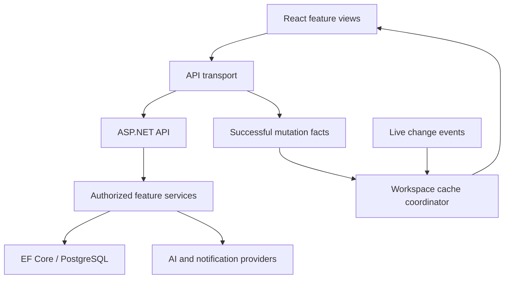

# Responsiveness, lightweight loading, AI and notification review

Reviewed source: b546657c6d38cf81381c0e02573058db5bfd4949. This is a targeted source review and regression change, not a complete production performance certification. Changes require CI, review and deployment.

## Architecture findings

The application already uses a layered .NET modular monolith (API, Application, Domain, Infrastructure) and route-split React/TypeScript. Keep those boundaries while extracting smaller feature services. Adding distributed services would add network hops and operational work without addressing the demonstrated UI bugs.

## Demonstrated causes and proposed fixes

| Symptom | Source cause | Change |
| --- | --- | --- |
| Created/edited/deleted work appears late | Some views depend on separate invalidation code; live handler ignores all same-user events, including another tab; time/timeline families absent | Emit facts only after successful writes, coalesce affected active queries at 50 ms, retain workspace-at-request-start; process same-user live events, add missing families, coalesce live bursts at 150 ms |
| Stale UI after returning online/tab focus | Global focus refetch disabled | Refetch stale queries on focus and reconnect; no forced full-page reload |
| Application downloads unused features | Idle prefetch walks every registered page | Load navigation destinations on hover/focus only, once per loader, longest route match, max four speculative loads, respecting data saver, slow connections and hidden tabs |
| Browser notifications absent despite local subscription | Local subscription existence suppresses fallback even when server registration has been lost | Re-register existing subscriptions at sign-in; suppress fallback only after server acknowledgment |
| Notification created during initial fetch can be missed | First poll discards the whole returned batch | Use mounted-time boundary, scope cursor by user/workspace, ignore results after unmount |
| AI turns 09:30–16:30 into generic 7h | Time tool exposes minutes/day only; runner omits existing service interval fields | Add paired local start/end input, validate duration/time zone, preserve UTC timestamps through approval to existing TimeService |
| A simple time-log follow-up reads a broad portfolio | Time keywords expose the complete tool catalog | Offer a focused time-log catalog for unambiguous logging follow-ups; preserve broad tools for compound requests |

Mutation refresh currently routes work/project/task, time, reminder, meeting/call/attendance and confirmed AI actions. Other feature-specific caches retain their existing invalidation. This does not establish that every mutation in every module is covered. No optimistic success is shown before server confirmation, and rejected requests emit no success event. Queries for other workspaces are not refetched by a late response.

## Measured build baseline

Existing CI build output (run 41402582149, job 125137513896) reports these emitted chunks. They are individual assets, not measured first-load totals:

| Chunk | Raw kB | gzip kB |
| --- | ---: | ---: |
| WorkPage | 192.22 | 54.34 |
| ProjectsHome | 229.94 | 69.29 |
| SettingsPage | 339.91 | 94.26 |
| CallPage | 659.26 | 180.20 |
| LibraryPage | 686.67 | 197.33 |
| Swagger UI | 1358.09 | 397.29 |

The immediate loading fix prevents the idle prefetch sweep; it does not claim these libraries became smaller. No new runtime dependency is introduced. Capture a browser network trace before/after deployment to quantify transferred bytes, request counts and interaction latency. Cold route loads still take network time; API/database/model latency is separate from cache refresh delay.

## GO Collect regression scope

For an existing authorized work key, 09:30–16:30 Asia/Kolkata is proposed as 420 minutes with UTC boundaries 04:00–11:00. Nothing is logged until confirmation. Both times must be supplied, match minutes, and describe a valid unambiguous same-day interval. Overnight spans or break deductions require clarification. Existing duration-only requests remain valid.

This change does not yet implement a single combined create-ticket + time-log + external-calendar approval. Native timeline/time views can use saved interval data, but the month calendar currently omits worked-time entries by design, and external calendars need their own explicit action. Do not tell users those actions all succeeded when only a ticket or timesheet entry was saved.

## Next architecture work and release checks

1. Complete a dependency-aware action plan for compound AI requests: declared requested outputs, references to newly created work IDs, one reviewable plan, per-step receipts and idempotent retry/undo. Preserve assignee versus time-owner distinction.
2. Split the large AiToolbox coordinator into feature tool handlers behind a registry. Keep authorization, schema validation and approval in shared execution infrastructure; feature services own business rules.
3. Move remaining feature writes to a documented mutation-effect registry with optimistic cache patches where rollback is defined. Add per-role coverage; personal/guest sessions currently do not mount the organizational chat live connection, so do not claim universal realtime delivery.
4. Isolate editor/Swagger/media libraries further based on real network and bundle evidence. Add route transfer budgets and performance traces; do not remove dependencies solely because their installed size is large.
5. Validate notifications on the actual browser or installed desktop app with site permission, OS notification settings, focus/do-not-disturb, mute/quiet-hours preferences, server push configuration, sign-out/sign-in, closed-tab delivery and minimized-tray delivery. Source changes cannot override an OS/browser denial. Electron requires the app process to remain running.
6. Stage normal and failed create/update/delete flows, two tabs with the same user, two users, Time/Calendar/Today, offline/reconnect and workspace switches. Verify rollback and no duplicate records.

## Validation

Local execution against the actual TypeScript modules passed mutation-family routing, tenant binding, read-loop avoidance, zero startup speculative downloads and deduplicated navigation intent. Whitespace/diff checks passed. Added frontend regressions cover prefetch, mutation routing and push-server acknowledgment; backend regressions cover interval validation and confirmed timestamp persistence. Full CI and production verification are tracked in the pull request; they are not claimed passed by this document.
