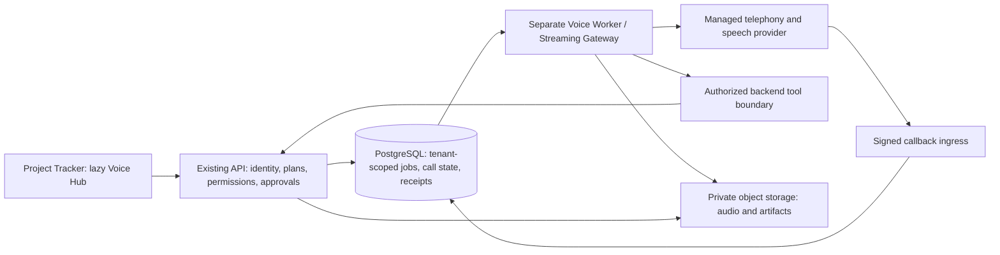

# Voice agents: follow-on release decision and repository audit

Decision recorded 11 October 2026: the user selected a follow-on voice release after the existing six release workstreams. This document defines an original Project Tracker module inspired by public product capabilities. It does not claim that calling, an employee studio or a separate voice runtime has been implemented.

## Public Outpero analysis and evidence limits

Public pages describe a configurable voice employee, scripts/questions, multilingual conversation, post-call summaries/extracted fields and integrations. The product site advertises campaigns, transcripts, sentiment and human handoff. These are useful requirements to evaluate, not independently tested accuracy or latency guarantees. [Outpero homepage](https://www.outpero.com/), [Outpero voice agents](https://www.outpero.com/ai-voice-agents)

The company's product overview describes inbound calls, instant lead calls and campaigns, with a Hyderabad company address. It advertises up to 30 concurrent campaign calls and pricing from INR4,999/month. The separate voice page advertises up to 20 concurrent calls, INR1,899/30 days plus usage from INR3/minute, and labels inbound handling as coming soon. The homepage instead lists zero base fee, INR3.5/5/7 per minute and INR649/month number rental. Public pages disagree about availability, concurrency and prices; request a controlled demonstration and current written quote before relying on them. [OpenDG products](https://www.opendg.org/products/), [Outpero voice agents](https://www.outpero.com/ai-voice-agents), [Outpero homepage](https://www.outpero.com/)

No authenticated vendor workspace, proprietary implementation, recordings, live calls or private operating metrics were audited. The public documentation shell did not expose readable technical documentation in this session. The attachment's deeper workflow suggestions are design inputs, not verified vendor features. Product marketing's compliance statements are not adopted as legal conclusions.

## Product placement

| Option | Implication | Recommendation |
| --- | --- | --- |
| All UI, audio and background processing inside the current API | Simple first deployment but calls compete with ordinary project requests for process resources | Avoid for live voice |
| Completely independent application | Separate identity, billing and data integrations add cost and customer administration | Reserve for a future distinct audience |
| Project Tracker module with a separate voice runtime | Shared account, organization, permissions, support and billing; independent call capacity | Start here |

Adding a feature does not automatically make the application heavy. Loading its assets on every page and sharing its processing budget with interactive requests does. Keep the Voice Hub as an optional lazy route and isolate its runtime. A separate branded frontend can later use the same authorized platform APIs without duplicating tenant identity or subscription logic.

## Verified architecture and reuse boundaries

The repository contains a React/TypeScript Vite SPA with lazy feature routes, workspace-scoped React Query and backend Domain/Application/Infrastructure/Api projects. PostgreSQL is the production relational store. CurrentContext, query filters, ProjectAccess, permissions and WorkspaceExecutionPrincipal enforce service boundaries; Recorder supplies audits. EntitlementService, AiCreditService and admission services already control access and shared text-AI spending.

Durable support workflows, private email and personal calendar confirmation receipts provide patterns for claims, approvals and uncertain-outcome reconciliation. Existing document versions, storage abstraction and authorized queries should supply knowledge evidence. WhatsApp connections and private phone proof are organization-bound; phone ownership is not authority to read project data, receive notifications or make calls.

Crucially, Infrastructure/DependencyInjection.cs currently registers background work through AddHostedService inside the API process. backend/Dockerfile publishes ProjectManagement.Api.dll. There is no separate voice worker or streaming gateway today. Splitting live voice is a new deployment step, not an existing isolation guarantee.

## Proposed runtime

Use one code repository and shared domain/application libraries initially. Add an explicit worker/gateway entrypoint instead of running a second copy of the API with every hosted service enabled. Choose one migration owner; the voice process must not run unrelated jobs or concurrent startup migrations. A combined voice worker/gateway service is sufficient initially; split it further only when measurements justify the operational cost.

On Railway, place API, voice service and database in the same project/environment, use authenticated private service communication and configure bounded database pools separately. Railway private networking scopes connectivity to that project/environment; private reachability does not replace service authentication. Configure streaming connection/drain behavior and cancellation before live calls. [Railway private networking](https://docs.railway.com/networking/private-networking)

Use managed inference/speech/telephony first and retain Gemini as the primary text interpretation/summarization provider through the existing AI pipeline. Verify any selected real-time speech API separately; a text model is not automatically a low-latency audio interface. A backup local model should receive only jobs it can finish within the remaining deadline. Do not send all failed voice sessions into the same saturated CPU queue. No dedicated GPU purchase is required by this initial design.

## Features and authoritative data

Employee Studio needs an immutable published revision containing instructions, authorized role/project scope, tools, language/voice settings, question flow, validated extraction schema, allowed knowledge versions, escalation rules and budgets. Drafts may be AI-assisted; publishing, rollback and consequential actions need authorized review. Editing a draft must not change calls already using an earlier revision.

Voice Hub needs paged calls, state/event history, summaries, extracted fields, permission-aware transcripts, protected recording access, handoffs and usage. Campaigns add tenant fairness, approved contact sets, calling windows, opt-outs, per-contact retry limits, expiry and concurrent-call caps. Never infer identity or permission from a telephone number or a model assertion.

Proposed new entities are employee/revision, voice connection, call session/event, campaign/item, purpose-specific consent, artifact metadata and usage/reservation/reconciliation records. These are proposals, not current migrations. Reuse existing tenants, users, project permissions, support tickets and finance ledgers instead of copying them into a second product.

Start retrieval with authorized structured SQL and document/version metadata. Add extraction and bounded keyword retrieval, then evaluate whether semantic or hybrid search improves real questions. Only add a separate vector service after measuring quality and operating cost. Return source/version references with recommendations; a transcript or uploaded document cannot instruct the agent to bypass permissions.

## First useful workflow: branch support

1. An authorized member creates a support ticket and proposes a call to an approved contact.
2. Backend checks purpose-specific calling consent, project permissions, current plan, quiet hours, approved script and cost/concurrency budgets.
3. Commit the durable call job and immutable employee revision before contacting the provider.
4. At pickup, disclose the purpose and apply the configured consent/recording policy. Recheck access before retrieving evidence or running a tool.
5. Collect evidence, ground suggestions in authorized current sources and propose permitted actions. Ambiguous identity or unsupported resolution goes to a human.
6. Record a verified outcome, summary, source versions, handoff and provider usage. Consequential changes follow existing confirmation services.

A WhatsApp link or notification opt-in grants neither voice-call nor recording consent. HR, lending/financial decisions, project reassignment and external writes must use scoped services and appropriate human confirmation; model output alone cannot execute them.

## Reliability, security and commercial boundaries

Use tenant-scoped durable jobs with leases, bounded retries, fairness and deduplication. Provider callback signatures, event ordering, replay windows and reconnect epochs must be verified. An uncertain call-creation outcome cannot be blindly redialed: reconcile through provider status using a stable request identity, or require review if that is unavailable.

Use a scoped backend capability binding tenant, authorized actor, published employee revision, resource/action, expiry and idempotency key. The worker must not accept tenant IDs supplied by callers as authorization, and must not receive an unrestricted administrator identity. Recheck current permissions when executing, including after pause/disconnect or membership changes.

Keep audio in private object storage with retention/deletion rules, short-lived authorized download URLs and audited access. Do not store audio blobs in PostgreSQL or include full transcripts in ordinary dashboard responses. Validate and isolate document parsing; sandbox arbitrary uploaded content and disallow arbitrary model-selected outbound URLs.

Meter voice usage separately from existing AI credits. Track provider-connected time, speech/model tokens, phone rental, artifacts and attributable operations. Enforce reservation and maximum-duration budgets before a call, then reconcile verified usage; do not charge twice for duplicate callbacks. Customer plan features should use the existing entitlement model, with separately configured minutes, call concurrency and spend caps. Do not publish unlimited capacity or copy vendor prices without a measured cost basis. A 20% gross margin requires price = attributable cost / 0.80, before separately handling taxes and wider business overhead; a 20% markup yields a smaller margin.

## Keeping the application fast

- Lazy-load Voice Hub and its SDK; dashboards should make no voice requests or open audio sockets.
- Paginate calls and return small summaries; fetch a transcript or recording only on explicit authorized access.
- Run call processing and document indexing outside the API request process; bound worker and database concurrency.
- Use cancellation, short interactive deadlines and readable queued/running/handoff states. Do not conceal capacity failures behind endless spinners.
- Measure dashboard bundle size and API p95 before/after; track DB pool saturation, queue age, connected calls, audio turn latency, source-grounding accuracy and cost per successful call.

Five thousand registered or active platform users is not five thousand simultaneous phone calls. Capacity depends on measured live-call arrival rate, duration, provider concurrency, CPU/memory per stream and tokens. Start with controlled call concurrency, measure representative bursts with simulated providers, and obtain provider capacity before promising higher live concurrency. Upgrading Railway raises resource ceilings; it does not remove external-provider latency. [Railway deployment troubleshooting](https://docs.railway.com/deployments/troubleshooting/slow-deployments)

## Follow-on delivery sequence

| Stage | Deliverable | Exit evidence |
| --- | --- | --- |
| V1. Studio and simulation | Reviewed employee versions, tenant/plan checks, call state and mock transcript flow | Two organizations isolated; zero real calls; unauthorized tools rejected |
| V2. Controlled voice runtime | Separate entrypoint, one configured provider, streaming, signed callbacks and recording access | Explicitly approved test numbers; cancellation, callback replay, crash recovery and uncertain outcomes verified |
| V3. Branch support loop | Ticket-to-call proposals, grounded summaries, approval/handoff and audited outcomes | No unsupported resolution or cross-project disclosure; consequential updates confirmed |
| V4. Campaigns and integrations | Opt-outs, quiet hours, fairness, durable delivery and verified usage accounting | Provider capacity/cost and consent gates verified; duplicate callbacks cannot double bill |
| V5. Role expansion and commercial launch | HR, project and technical workflows; approved financial scope; evaluated plans | Accuracy, access, accessibility, cost and operational checks pass |

These stages follow the existing six workstreams in implementation-plan.md. Existing WhatsApp/productivity/support/resume/payment/production release gates remain open; this design does not advance their status to complete. Automated verification uses mocked voice/AI providers and isolated data. No AI bulk tests, real customer calls, recordings or external writes are part of the current checkpoint.
